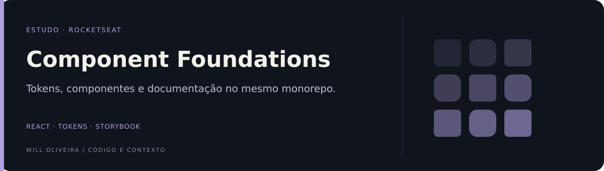

<p align="center">
  
</p>

# Design system · componentes React e tokens

Monorepo de estudo para separar tokens visuais, componentes React e documentação em Storybook. Projeto associado ao aprendizado da trilha Ignite da Rocketseat; é independente do [Will Labs](https://github.com/Will-Ifes/will-labs).

**React · TypeScript · Stitches · Radix · Storybook · Turborepo · tsup**

## Explore o diferencial

| Ponto de entrada | O que observar |
| --- | --- |
| [Contrato compartilhado](packages/react/src/index.tsx) | O pacote React define o conjunto de componentes exportados. |
| [Componente documentado](packages/docs/src/stories/Button.stories.tsx) | As stories do botão permitem examinar variações da mesma interface. |

## Conteúdo implementado

O código exporta `Text`, `Heading`, `Box`, `Button`, `TextInput` e `Avatar`. O README anterior listava também TextArea, Checkbox e MultiStep como objetivos; eles não estão exportados na versão atual.

<details>
<summary><strong>Organização e código</strong></summary>

### Arquitetura

| Pacote | Responsabilidade |
| --- | --- |
| [packages/tokens](packages/tokens) | Cores, tipografia, espaçamento e raios |
| [packages/react](packages/react) | Componentes e estilos |
| [packages/docs](packages/docs) | Stories e páginas de tokens |
| [packages/eslint-config](packages/eslint-config) | Configuração compartilhada de lint |
| [packages/ts-config](packages/ts-config) | Configuração compartilhada de TypeScript |

A separação permite que documentação e componentes utilizem os mesmos tokens. A build dos pacotes usa tsup; o Turborepo coordena os comandos dos workspaces.

### Por dentro do código

- [Exportações do pacote React](packages/react/src/index.tsx).
- [Contrato e estilo do botão](packages/react/components/Button.tsx).
- [Tokens de cores](packages/tokens/src/colors.ts).
- [Stories do botão](packages/docs/src/stories/Button.stories.tsx).

</details>

<details>
<summary><strong>Executar e consultar</strong></summary>

### Executar

```bash
git clone https://github.com/Will-Ifes/design-system.git
cd design-system
npm install
npm run dev
```

O Storybook está configurado na porta 6006. Para gerar os pacotes e a documentação:

```bash
npm run build
```

</details>

<details>
<summary>Escopo e referências</summary>

É uma base educacional, sem declaração de homologação ou publicação atual dos pacotes. O script de teste de `packages/docs` é um placeholder. Testes de interação, acessibilidade e revisão dos contratos são próximas melhorias.

</details>

---

Mantido por **Will Oliveira** · [Perfil](https://github.com/Will-Ifes) · [LinkedIn](https://www.linkedin.com/in/wildemberg-de-jesus-oliveira/)
